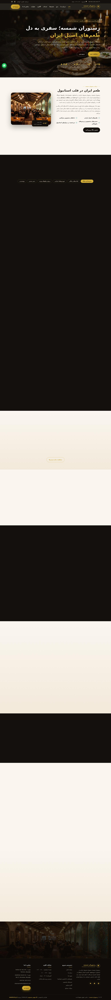
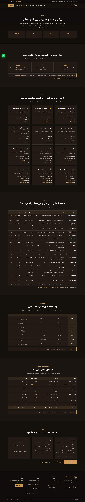
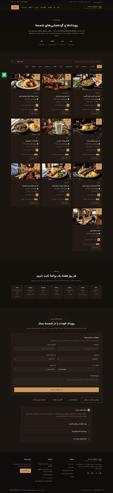

# 🌟 وب‌سایت رستوران شمسه | Shamse Restaurants Website

وب‌سایت تک‌صفحه‌ای (One-Page) مدرن، راست‌به‌چپ و کاملاً واکنش‌گرا برای **رستوران شمسه** — رستوران معروف ایرانی در استانبول با **دو شعبه**: تکسیم (خیابان استقلال) و کوجاتپه (شمسه سو کلاب). ساخته‌شده با HTML/CSS/JavaScript خالص و **بدون هیچ کتابخانه‌ی بیرونی** (بدون jQuery، بدون Bootstrap، بدون CDN).

> 🎨 **طراحی و کدنویسی ۱۰۰٪ با هوش مصنوعی** — پروژه‌ی `shamse-restaurant` در سازمان [Websites-by-AI](https://github.com/Websites-by-AI)

[](https://websites-by-ai.github.io/shamse-restaurant/)
[](https://shamse-restaurant.pages.dev)
[](https://huggingface.co/spaces/Sosa654321/shamse-restaurant)
[](#)

## 🚀 سه پلتفرم، یک سایت (همه از همین مخزن به‌روز می‌شوند)

| پلتفرم | نشانی زنده | استقرار |
|---|---|---|
| 🐙 **GitHub Pages** | https://websites-by-ai.github.io/shamse-restaurant/ | خودکار (از برنچ `main`) |
| 🌩 **Cloudflare Pages** | https://shamse-restaurant.pages.dev | خودکار با GitHub Actions |
| 🤗 **Hugging Face Space** | https://huggingface.co/spaces/Sosa654321/shamse-restaurant | خودکار با GitHub Actions |

> هر بار که روی برنچ `main` پوش می‌کنید، فایل `.github/workflows/deploy.yml` سایت را به‌صورت خودکار روی **Cloudflare Pages** و **Hugging Face Space** منتشر می‌کند.
> برای اجرای دستی: GitHub → Actions → «Deploy website» → Run workflow.

---

## 🖼 پیش‌نمایش



<details>
<summary>📱 نمای موبایل (کلیک کنید)</summary>


</details>

<details>
<summary>📣 صفحهٔ استراتژی و مارکتینگ (marketing.html)</summary>



</details>

<details>
<summary>📅 صفحهٔ رویدادها (events.html)</summary>



</details>

---

## 🤖 ربات و کانال تلگرام — @shamse_restaurant_bot

ربات رسمی شمسه در تلگرام: <https://t.me/shamse_restaurant_bot>

| قابلیت | توضیح |
|---|---|
| 💬 پاسخ خودکار | دستورهای `/menu` `/events` `/reserve` `/branches` `/contact` با دکمه‌های لینک (هر ۳۰ دقیقه بررسی می‌شود) |
| 📣 پست خودکار کانال | سه‌شنبه/چهارشنبه/جمعه ساعت ۱۲:۰۰ استانبول (۰۹:۰۰ UTC) — ۱۵ موضوع چرخشی (منو، رویدادها، طبقهٔ میتاپ، شعبه‌ها) |
| 🧠 متن با هوش مصنوعی | اول با **GitHub Models** (`openai/gpt-4o-mini`) از طریق توکن خود مخزن، و در صورت نبود/خطا، **قالب آمادهٔ فارسی** — پس پست هرگز نمی‌ماند |
| 🖼 پست تصویری | عکس از خود سایت (`assets/img/…`) با کپشن؛ در صورت خطا، پست متنی |
| 🔎 کشف خودکار کانال | کافی است ربات را در کانال ادمین کنید؛ شناسهٔ کانال خودکار پیدا و در `automation/state.json` نگه داشته می‌شود |
| 🧾 پروفایل ربات | نام، About، توضیحات و فهرست دستورها به‌صورت فارسی تنظیم شده است |

فایل‌ها: `automation/telegram_bot.py` (منطق) · `automation/content.py` (بانک محتوا) · `.github/workflows/telegram.yml` (زمان‌بندی)

### راه‌اندازی کامل (۴ قدم)
1. در تلگرام یک **کانال** بسازید (مثلاً «رستوران شمسه | استانبول») و ربات `@shamse_restaurant_bot` را به‌عنوان **ادمین** اضافه کنید.
2. یک پیام تستی در کانال بفرستید (تا ربات آن را ببیند).
3. در گیت‌هاب → **Actions → Telegram bot (شمسه) → Run workflow**:
   - اول `selftest` بزنید (سلامت توکن/کانال/هوش مصنوعی را چک می‌کند)،
   - با `discover` شناسهٔ کانال را ببینید و اگر خواستید آن را در **Settings → Variables** با نام `TELEGRAM_CHAT_ID` ثبت کنید،
   - در پایان `post` با `dry_run=false` برای اولین پست واقعی (یا `dry_run=true` فقط برای پیش‌نمایش متن).
4. تمام — از این پس پست‌ها و پاسخ‌های خودکار طبق زمان‌بندی اجرا می‌شوند.

### امنیت
- توکن ربات فقط در **GitHub Secret** با نام `TELEGRAM_BOT_TOKEN` ذخیره شده و هرگز در کد/مخزن نوشته نمی‌شود.
- برای تعویض توکن: در تلگرام `@BotFather` → `/revoke` → توکن جدید → `Settings → Secrets and variables → Actions → TELEGRAM_BOT_TOKEN` را به‌روز کنید.
- متغیر `AI_PROVIDER=github` برای فعال بودن تولید متن با هوش مصنوعی تنظیم شده است (برای خاموش‌کردن: مقدار `none`).

---

## 🤝 طبقهٔ میتاپ (Meetup) — شعبه استقلال، دو طبقه

شعبهٔ خیابان استقلال **دو طبقه** دارد:
- **طبقهٔ همکف** → سالن اصلی رستوران
- **طبقهٔ دوم** → **طبقهٔ اختصاصی میتاپ** برای گردهمایی گروه‌های ایرانی و رویدادهای اجتماعی/حرفه‌ای (ظرفیت تا ۶۰ نفر، پروژکتور، میکروفون، وای‌فای، منوی گروهی حلال)

### 🔗 لینک‌های Meetup استفاده‌شده (همه تست و تأیید شدند)

| گروه | مناسب برای | لینک |
|---|---|---|
| Speak Easy — Language & Culture \| Istanbul (۲٬۷۵۵ عضو) | تبادل زبان و مکالمه | https://www.meetup.com/speakeasy-istanbul/ |
| Iranian groups (۱۷٬۶۰۰+ عضو / ۲۸ گروه) | دورهمی و شبکه‌سازی ایرانیان | https://www.meetup.com/topics/iranian/ |
| Iranian Culture | فرهنگ، کافه‌کتاب، شب شعر | https://www.meetup.com/topics/iranians-get-together/ |
| Persian Friends | شبکهٔ متخصصان و دوستان پارسی | https://www.meetup.com/topics/persians/ |
| Farsi Language | تمرین فارسی برای غیرفارسی‌زبان‌ها | https://www.meetup.com/topics/farsi/ |
| تبادل زبان در استانبول | رویدادهای زبان‌آموزی شهر | https://www.meetup.com/find/tr--istanbul/language-exchange/ |
| رویدادهای بین‌المللی استانبول | میتاپ‌های بین‌المللی | https://www.meetup.com/find/tr--istanbul/international-friends/ |

> ⚠️ لینک‌های `meetup.com/istanbul-language-and-culture-exchange-meetup` و `meetup.com/find/tr--istanbul/iranian/` تست شدند و **۴۰۴** برمی‌گردانند؛ در سایت استفاده نشده‌اند.

## 🏢 دو شعبه در سایت

سایت به‌صورت اختصاصی برای ساختار دو‌شعبه‌ای شمسه طراحی شده است:

| | شعبه ۱ — تکسیم (اصلی) | شعبه ۲ — کوجاتپه (سو کلاب) |
|---|---|---|
| **آدرس** | İstiklal Cd. No:179, Tomtom, 34440 Beyoğlu | Kocatepe, Abdülhak Hamit Cd. No:17, 34040 Beyoğlu |
| **شناخته‌شده برای** | سه طبقه سالن مجزا، تراس، موسیقی زنده | سالن مراسم و جشن، دی‌جی و شب‌های موسیقی |
| **ساعت کاری** | همه‌روزه ۱۲:۰۰ – ۰۱:۳۰ | همه‌روزه ۱۲:۰۰ – ۰۱:۳۰ |
| **تلفن** | ‎+90 501 325 24 52 | ‎+90 501 325 24 52 |

**در سایت چه چیزهایی دو‌شعبه‌ای است؟**
- بخش کامل **«شعبه‌های ما»** با کارت مستقل هر شعبه، آدرس و **دکمه‌ی مسیریابی در گوگل‌مپ**
- فرم رزرو با **انتخابگر شعبه**؛ دکمه‌ی «رزرو در این شعبه» هر کارت، شعبه را در فرم **از پیش انتخاب** می‌کند
- کارت اطلاعات تماس، فوتر، سوالات متداول و داده‌های ساخت‌یافته (schema.org) برای **هر دو شعبه** جداگانه

---

## ✨ امکانات

| بخش | توضیحات |
|---|---|
| 🏠 **هیرو (Hero)** | تصویر تمام‌صفحه با افکت Ken-Burns، چیدمان وسط‌چین، شمارنده‌های فارسی (۷۲+ آیتم منو، ۲ شعبه، ۱۲۰+ ظرفیت، امتیاز ۴٫۸★) |
| 📖 **درباره ما** | معرفی رستوران با تاریخچه‌ی دو شعبه + قاب تصویر طلایی |
| 🍽 **منوی تعاملی** | ۶ دستهٔ منو (پیش‌غذا، کباب، خورش، پلو، دسر، نوشیدنی) با تب‌های کلیک‌شدنی و عوض‌شدن تصویر هر دسته |
| 🏢 **شعبه‌ها** | دو کارت کامل شعبه با تصویر، آدرس، تلفن، ویژگی‌ها و دکمه رزرو/مسیریابی |
| 🤝 **میتاپ (طبقهٔ دوم استقلال)** | معرفی طبقهٔ اختصاصی میتاپ با ظرفیت ۶۰ نفر + ۶ کارت جامعهٔ گروهی (تبادل زبان، شبکه‌سازی ایرانیان، کافه‌کتاب، شب موسیقی، شبکهٔ متخصصان، تمرین فارسی) با **لینک‌های واقعی و بررسی‌شدهٔ Meetup** + ۴ قدم میزبانی |
| 📣 **صفحهٔ استراتژی و مارکتینگ** (`marketing.html`) | صفحهٔ جداگانهٔ رشد: ۱۲ مدل رویداد برای پر کردن طبقهٔ دوم و ساعت‌های خلوت، جدول ۱۷ پلتفرم/استارتاپ واقعی (RestauRent، Peerspace، Tagvenue، Biletino، Luma…) با لینک بررسی‌شده، تقویم هفتگی پیشنهادی، جدول درآمد نمونه و نقشهٔ راه ۳۰/۶۰/۹۰ روز |
| 📅 **صفحهٔ رویدادها** (`events.html`) | تجربهٔ شبیه Meetup: ۱۰ رویداد نمونه با فیلتر دسته‌بندی، جست‌وجو و مرتب‌سازی، دکمهٔ **شرکت می‌کنم** با شمارش و ذخیره در مرورگر، ریتم هفتگی، و فرم **میزبانی رویداد** (اعتبارسنجی + افزودن کارت به تقویم) |
| 🥘 **سینی‌های مخصوص** | کارت‌های خانوادگی با افکت زوم |
| 🛎 **خدمات** | سالن دو طبقه و تراس، بیرون‌بر، مراسم و کلاب، منوی گیاهی |
| 📝 **مقالات (بلاگ)** | ۶ نوشتهٔ کوتاه (آشپزخانه، راهنمای شهر، گیاهی، رویدادها، جامعه) با **مودال متن کامل** و دکمهٔ «مشاهده مقالات بیشتر» |
| 🖼 **گالری تصاویر** | چیدمان نامتقارن + **لایت‌باکس** (بستن با Esc) |
| 💬 **نظرات مهمانان** | کارت‌های امتیازدار با ستاره |
| 📅 **فرم رزرو میز** | انتخاب **شعبه** + اعتبارسنجی کامل (نام، تلفن، تاریخ، ساعت، نفرات) و پیام موفقیت |
| 📍 **اطلاعات تماس** | آدرس هر دو شعبه، تلفن، واتساپ، ایمیل و ساعات کاری |
| ❓ **سوالات متداول** | آکاردئون؛ اولین سؤال: «شمسه چند شعبه دارد و کجا هستند؟» |
| 🟢 **شناورها** | دکمهٔ واتساپ، دکمهٔ بازگشت به بالا، هدر چسبان، منوی موبایل |

### 🎨 تم و چیدمان (هم‌سان‌شده با سایت مرجع شمسه)
پالت و تایپوگرافی **از داخل مرورگر سایت مرجع اندازه‌گیری و به‌صورت فنی بازتولید شده است** (بدون کپی کد یا محتوا):

| توکن | مقدار اندازه‌گیری‌شده از مرجع |
|---|---|
| پس‌زمینه | `#13100c` قهوه‌ای-گردویی تیره |
| اکسنت | `#d29a5a` مسی |
| متن | `#d1c8bb` · تیتر `#f8f8f8` · متن روی دکمه `#101e22` |
| فونت | Vazirmatn — h1 **56px/800** · h2 ~۳۷px/800 · بدنه ۱۶px |
| دکمه‌ها | چهارگوش (`border-radius:0`)، پر مسی، padding ۱۶/۳۲ |
| ریتم بخش‌ها | ۱۲۰px عمودی |
| هدر | شفاف روی هیرو → تیره پس از اسکرول |

### ویژگی‌های فنی
- ✅ راست‌به‌چپ کامل (`dir="rtl"`) با **فونت واقعی Vazirmatn** — همان فونت سایت مرجع، میزبانی‌شده در خود پروژه (`assets/fonts/Vazirmatn-Variable.woff2`، متغیر ۱۰۰–۹۰۰، بدون درخواست به گوگل/CDN)
- ✅ **بدون هیچ منبع خارجی** — کاملاً آفلاین: فونت woff2 میزبانی‌شده، آیکون‌های SVG درون‌خطی، تصاویر محلی
- ✅ صفر درخواست به دامنهٔ ثالث (بدون Google Fonts، CDN، آنالیتیکس)
- ✅ **واکنش‌گرا**: دسکتاپ / تبلت / موبایل (شکست‌های ۱۰۸۰ / ۹۰۰ / ۶۴۰ پیکسل)
- ✅ **SEO**: Open Graph، توییتر کارت، دو ورودی `Restaurant` در `schema.org` (هر شعبه)، hreflang آماده
- ✅ **دسترس‌پذیری**: `aria`، ناوبری کیبورد، احترام به `prefers-reduced-motion`
- ✅ انیمیشن‌های ظاهرشدن با `IntersectionObserver`

---

## 📂 ساختار پروژه

```
shamse-restaurant/
├── index.html            ← سایت نهایی (GitHub Pages)
├── preview.html          ← نسخهٔ تک‌فایلِ خودبسنده (تصاویر base64 درون فایل)
├── build.py              ← اسکریپت ساخت (سایت عادی + نسخهٔ تک‌فایل)
├── .github/workflows/    ← انتشار خودکار روی Cloudflare Pages و Hugging Face
├── DEPLOY.md             ← راهنمای سه پلتفرم
├── src/
│   └── page.html         ← سورس قالب (منبع ویرایش)
├── assets/
│   ├── img/              ← تصاویر (تولیدشده با هوش مصنوعی)
│   └── fonts/            ← فونت Vazirmatn میزبانی‌شده (woff2 متغیر)
├── docs/                 ← اسکرین‌شات‌های README
└── README.md
```

> ✏️ **برای ویرایش:** فایل `src/page.html` را تغییر دهید و `python3 build.py` را اجرا کنید (خروجی‌ها خودکار ساخته می‌شوند).

---

## 🚀 اجرا و انتشار

```bash
# اجرای محلی
python3 -m http.server 8000      # سپس http://localhost:8000

# یا فقط فایل را باز کنید
start index.html      # ویندوز
open  index.html      # مک
```

**انتشار خودکار:** با هر پوش روی `main`، ورک‌فلوی `.github/workflows/deploy.yml` این کارها را انجام می‌دهد:

1. **Cloudflare Pages** → پروژهٔ `shamse-restaurant` (آدرس: https://shamse-restaurant.pages.dev) با هدرهای کش و امنیتی (`_headers`)
2. **Hugging Face Space** → اسپیس استاتیک `Sosa654321/shamse-restaurant` (آپلود با `huggingface_hub` + Xet)

سه سکرت لازم در مخزن (Settings → Secrets and variables → Actions):

| Secret | توضیح |
|---|---|
| `CLOUDFLARE_API_TOKEN` | توکن با دسترسی *Cloudflare Pages: Edit* |
| `CLOUDFLARE_ACCOUNT_ID` | شناسهٔ اکانت کلادفلر |
| `HF_TOKEN` | توکن Hugging Face با دسترسی *Write* |

> ⚠️ اگر توکن‌ها را Revoke/Roll کنید، مقدار سکرت‌ها را هم در همین صفحه به‌روز کنید وگرنه انتشار خودکار خطا می‌دهد.
> (GitHub Pages جدا از این‌هاست و از تنظیمات خود مخزن منتشر می‌شود.)

---

## ⚙️ شخصی‌سازی سریع

| چه چیزی | کجا |
|---|---|
| تلفن / واتساپ | جست‌وجوی `905013252452` در `src/page.html` |
| آدرس شعبه‌ها | بخش `#branches`، کارت `#contact` و `footer` |
| اینستاگرام / یوتیوب | بخش `socials` و `sameAs` در JSON-LD |
| رنگ طلایی | CSS: `--gold: #d4af37` |
| منو و قیمت‌ها | بخش `#dishes` (هر آیتم یک `<article class="dish" data-cat="...">`) |
| تصاویر | جایگزینی فایل‌های `assets/img/*.jpg` (با همان نام‌ها) |

---

## 🖼 دربارهٔ تصاویر

همهٔ تصاویر با **هوش مصنوعی تولید شده‌اند** و برای جایگزینی با عکس‌های واقعی رستوران در نظر گرفته شده‌اند.
این پروژه یک بازطراحی **اورجینال** است؛ هیچ فایل، کد، متن یا تصویری از سایت‌های دیگر کپی نشده است.
اطلاعات آدرس/تلفن شعبه‌ها بر اساس منابع عمومی (Google Maps، Tripadvisor و راهنماهای گردشگری) وارد شده و پیش از انتشار نهایی باید تأیید شود.

---

## 🔐 نکتهٔ امنیتی مهم

هرگز توکن‌های GitHub (`ghp_...`)، کلیدهای Cloudflare (`cfat_...`) یا Hugging Face (`hf_...`) را
در کد، مخزن عمومی، README یا اسکرین‌شات قرار ندهید. اگر توکنی منتشر شد، بلافاصله آن را در
[GitHub → Settings → Developer settings → Tokens](https://github.com/settings/tokens) **Revoke** کنید.
این پروژه هیچ توکنی را نگه نمی‌دارد و برای اجرا به هیچ کلیدی نیاز ندارد.

---

## 📄 مجوز

کد این پروژه تحت مجوز **MIT** منتشر شده است — آزادانه استفاده، تغییر و انتشار دهید.
